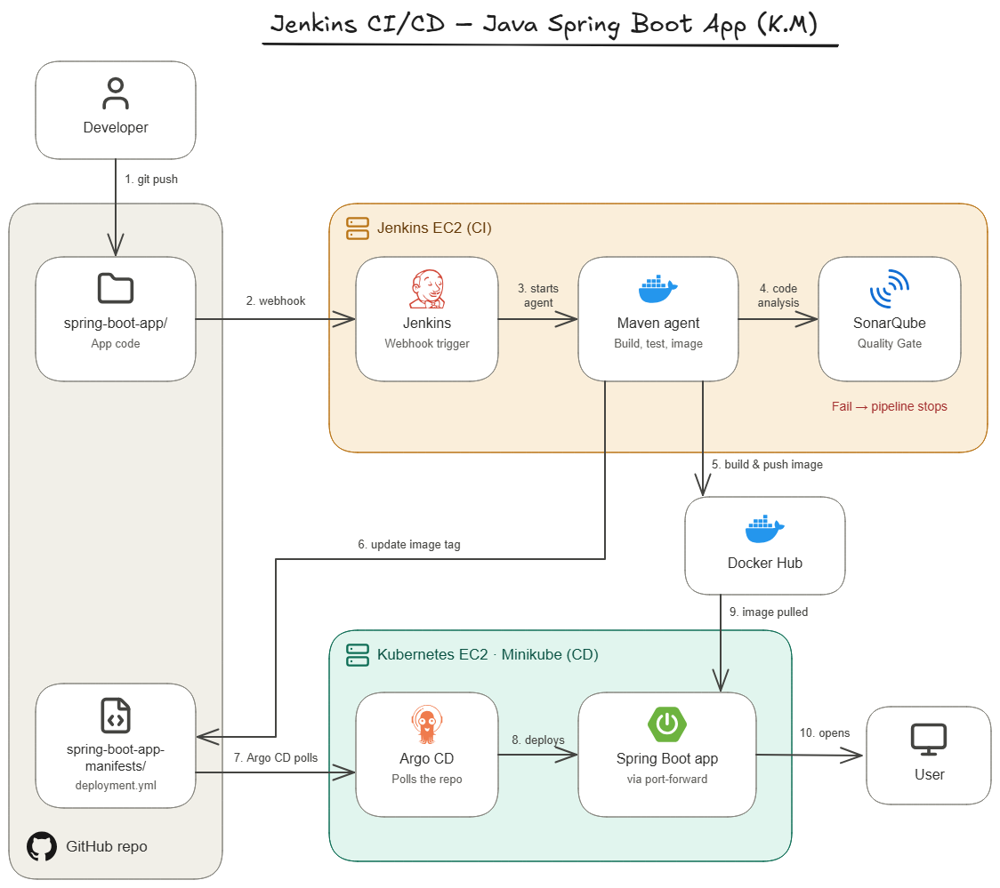
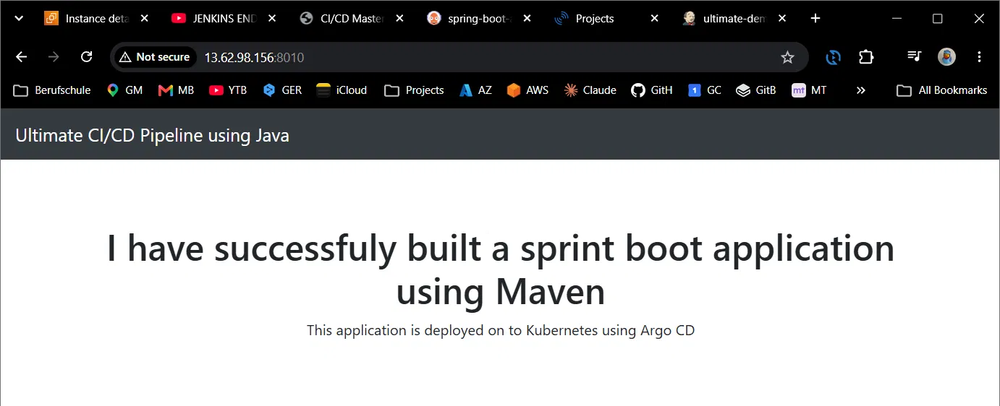
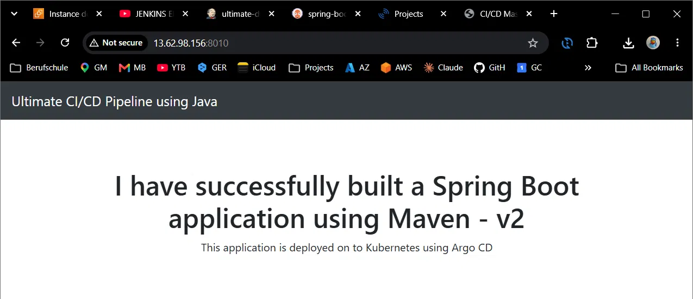
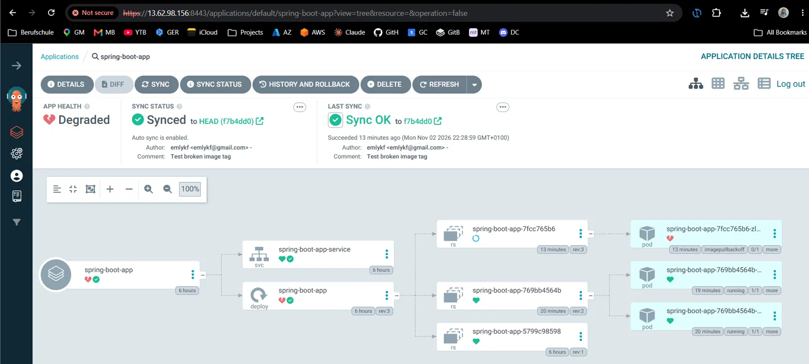
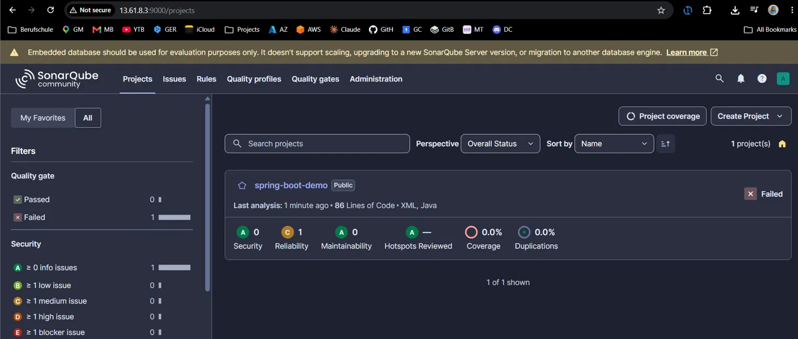

# Jenkins CI/CD – Java Spring Boot App

Automating the build, code analysis and deployment of a Java Spring Boot app: Jenkins builds and tests the app with Maven, SonarQube checks the code quality, and Argo CD watches the Git repo and automatically deploys every new version to Kubernetes (Minikube).



## Notes

- **Why a Docker agent?** – every build runs in a fresh container with Maven, Java and Docker, so nothing has to be installed on the Jenkins server and no old build leaves anything behind.
- **Why SonarQube with a Quality Gate?** – it checks the code on every build, and if the code fails the Quality Gate, the pipeline stops before anything gets deployed.
- **Why Argo CD?** – GitOps: Git is the single source of truth, and Argo CD keeps the cluster in sync with it.
- **Why two EC2 instances?** – CI (Jenkins) and CD (Argo CD) are separated and only connected through GitHub.
- **Why port-forward?** – Minikube runs inside Docker on the EC2, so its services aren't reachable from outside. That's fine for a demo; in production, Argo CD and the app would run on a managed cluster like EKS behind an Ingress.

## Challenges & How I Resolved Them

### 1. Old Docker Client in the Jenkins Agent

**Problem:** The Docker build failed with `client version 1.41 is too old`, because the agent image was 3 years old and its Docker client couldn't talk to the current Docker on my EC2.

**Solution:** Built my own agent image:

- `FROM maven:3.9-eclipse-temurin-11`: official Maven image with Java 11 for the app
- `COPY --from=docker:cli ...`: copies the current Docker client into it
- `newgrp docker`: refreshed my SSH session so I could use Docker without sudo
- `docker build -t emlykf/maven-docker-agent:v1 .`: built the image on the Jenkins EC2
- Updated the agent image in the Jenkinsfile

**Result:** The pipeline uses a current Docker client and no longer depends on an outdated image.

---

### 2. Minikube Ran Out of Memory

**Problem:** The Argo CD UI and `kubectl` timed out, because the instance had only 272 MB of memory left.

**Solution:** Upgraded the instance from 4 GB to 8 GB, recreated Minikube with `minikube start --memory=6g` and reinstalled Argo CD.

**Result:** Argo CD and the app run smoothly.

---

### 3. Jenkins Couldn't Fetch the Code After a Successful Build

**Problem:** The build failed at the start with `insufficient permission ... .git/objects`, because the last build's Git commit (made as root inside the container) left files Jenkins wasn't allowed to change. Like a boss saving files in an employee's folder that only the boss can edit.

**Solution:** Gave the folder back with `sudo chown -R jenkins:jenkins /var/lib/jenkins/workspace/ultimate-demo`, and added a `post` block to the Jenkinsfile that does this after every build.

**Result:** Every build leaves the workspace owned by Jenkins.

---

### 4. The Image Tag Was Only Updated Once

**Problem:** The second deployment failed with `nothing to commit`, because `sed` searched for the placeholder `replaceImageTag`, which was already replaced in the first build.

**Solution:** Changed `sed` to replace whatever tag is in the image line:

```bash
sed -i "s|image: emlykf/ultimate-cicd:.*|image: emlykf/ultimate-cicd:${BUILD_NUMBER}|" spring-boot-app-manifests/deployment.yml
```

**Result:** Every build updates the image tag, so Argo CD gets each new version.

---

### 5. The Webhook Started an Endless Build Loop

**Problem:** After adding the GitHub webhook, every build started another one, because the pipeline's own commit (the new image tag in `deployment.yml`) also triggered the webhook. The excluded path for the manifests folder was ignored, since Jenkins only compared commit IDs (`git ls-remote`) and never looked at which files changed.

**Solution:** In the Jenkins job, added **Force polling using workspace** next to **Polling ignores commits in certain paths** (`spring-boot-app-manifests/.*`), so Jenkins checks the changed files.

**Result:** A push to the app code starts exactly one build, and the pipeline's own commit is ignored.

### More smaller problems and how I fixed them: [other-challenges.md](other-challenges.md) 

## Test Scenarios
 
### 1. Deploying a Code Change 
 
**Test:** The app's title had two typos. The fix should go live without deploying anything by hand.
 
**What happened:** I fixed the title in `StartApplication.java` and pushed it. The webhook started the pipeline: Jenkins built, tested and scanned the app, pushed the new image and updated `deployment.yml`. Argo CD saw the change and rolled out the new version.
 
**Result:** The fixed "v2" title was live in a few minutes, without touching Kubernetes myself.
 
Before:

 

After:



---
 
### 2. Pushing a Broken Image Tag to Git



**Test:** I pushed a `deployment.yml` with an image tag that doesn't exist (`:999`).
 
**What happened:** The new pod couldn't pull the image, and Argo CD showed the app as Degraded. I undid the change with `git revert HEAD` and pushed it, and Argo CD synced the old version back automatically.
 
**Result:** The app stayed online the whole time, because Kubernetes kept the old pods running until a new one was healthy.
 
---

### 3. Stopping Bad Code with the Quality Gate


 
**Test:** I added bad code on purpose to see if the pipeline would stop it.
 
**What happened:** SonarQube found a bug (`env == "prod"`) and the Quality Gate failed, but the build stayed green and the bad code was deployed anyway. I added `-Dsonar.qualitygate.wait=true` to the SonarQube command in the Jenkinsfile, so Jenkins waits for the Quality Gate result.
 
**Result:** The next build stopped at Static Code Analysis and nothing was deployed. After removing the bad code, the pipeline went green again.

## 📝 Credit

Inspired by @iam-veeramalla. Upgraded setup, fixes and test scenarios by me.